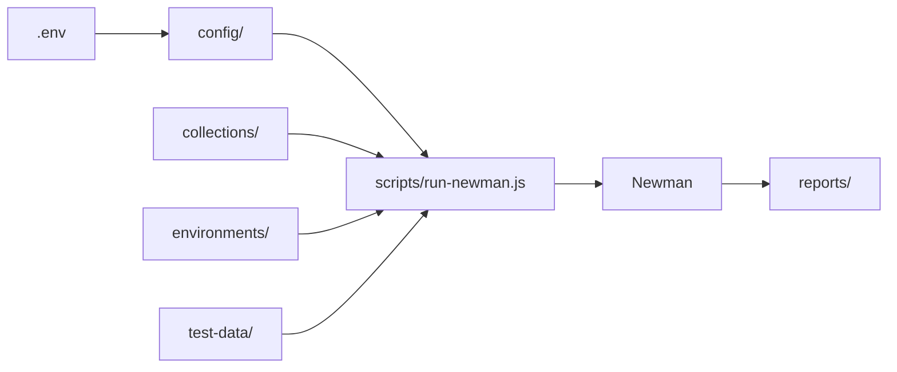

# Architecture

## Diagram



Postman collection + Newman runner for the JSONPlaceholder demo API.
One collection, two environments, one config file, one runner.

## Folder tree

```text
postman-newman-api-collections/
├── .env.example                  # safe local overrides (copy to .env, never committed)
├── .gitignore
├── ARCHITECTURE.md               # this file
├── README.md
├── package.json                  # Newman devDependency + npm test scripts
├── collections/
│   └── jsonplaceholder-api.postman_collection.json   # the 10 requests + 33 assertions
├── config/
│   └── newman.config.json        # Newman defaults: collection, envs, timeouts, reporters
├── docs/
│   ├── SETUP.md                  # install + run
│   └── TESTING.md                # what is tested + how to read reports
├── environments/
│   ├── dev.postman_environment.json    # demo API, envName=dev
│   └── prod.postman_environment.json   # same demo API, envName=prod
├── scripts/
│   ├── run-newman.js             # Node runner: config + env vars + Newman API
│   ├── run-newman.sh             # thin wrapper for macOS / Linux
│   └── run-newman.bat            # thin wrapper for Windows
├── test-data/
│   ├── README.md
│   ├── posts.json                # 3-row iteration data (JSON)
│   ├── posts.csv                 # same 3 rows (CSV)
│   └── users.json                # reference sample users (not an iteration file)
└── reports/                      # generated by runs (git-ignored)
    ├── report.html
    └── report.json
```

## Why each folder exists

| Folder | Purpose |
| --- | --- |
| `collections/` | The test asset itself. One Postman collection file, exported as JSON. Never hand-edit the raw JSON if Postman is available; import, edit, re-export. |
| `environments/` | Per-environment values. The only things that differ per environment are the values in these files. Both point at the same demo API here; in a real project `prod` would point at the real backend. |
| `config/` | Run settings that are not environment values: which collection, timeouts, delay, iteration count, reporters, report paths. One file so the runner, the shell wrappers and CI all agree. |
| `scripts/` | The only code in the repo. `run-newman.js` is the real runner; the `.sh` / `.bat` files are thin wrappers that check prerequisites and forward arguments. |
| `test-data/` | Data fed into runs. Iteration files drive data-driven runs; reference files document expected shapes. Kept apart from the collection so data can change without touching a request. |
| `docs/` | Human instructions: setup and testing. Kept out of the README so the README stays a short entry point. |
| `reports/` | Generated output only. Nothing in here is source; it is recreated on every run and ignored by git. |

## Data flow

```text
.env / shell env vars ─┐
config/newman.config.json ─┤
                         ▼
              scripts/run-newman.js
                         │  resolves: collection, environment,
                         │  data file, timeouts, reporters
                         ▼
              ┌──────────────────┐
              │  Newman (node)   │
              └──────────────────┘
                         │
        ┌────────────────┼────────────────┐
        ▼                ▼                ▼
  collections/    environments/     test-data/
  (requests +     (baseUrl, ids,    (payload values
   assertions)     timeout, labels)  per iteration)
        │                │                │
        └────────────────┴────────────────┘
                         ▼
              JSONPlaceholder demo API
                         ▼
              reports/report.html + report.json
              terminal output + exit code 0/1
```

## How config / environments / test-data / collections connect

Variable resolution order in Postman/Newman (first match wins):

1. **Iteration data** — one row of `test-data/posts.json` (or `.csv`)
   per run of the whole collection. Highest priority.
2. **Environment** — `environments/dev|prod.postman_environment.json`,
   selected by `NEWMAN_ENV` / `--env`. Carries `baseUrl`, `envName`,
   `postId`, `userId`, `maxResponseTimeMs`, `nonExistentPostId`.
3. **Collection variables** — defaults stored in the collection file
   itself, so the collection still runs standalone in Postman with no
   environment and no data file. Carries the same ids/timeout plus the
   payload defaults (`newPostTitle`, `newPostBody`, `updatedPostTitle`,
   `updatedPostBody`, `patchedPostTitle`).
4. **Runner overrides** — `BASE_URL` rewrites `baseUrl` in the loaded
   environment before the run; `NEWMAN_*` vars / CLI flags rewrite the
   config values (timeouts, iterations, delay, reporters, data file).

Requests use `{{baseUrl}}`, `{{postId}}`, `{{userId}}`,
`{{nonExistentPostId}}` and `{{newPostTitle}}` etc. in URLs and bodies.
Test scripts never hard-code those values; they read them with
`pm.variables.get(...)` (with a `|| <default>` fallback so a missing
variable fails loudly on the assertion, not on a crash). The only
literal host in the repo is the `baseUrl` default value itself
(`https://jsonplaceholder.typicode.com`), which lives in the collection
variables and both environment files as the demo default.

## How to add a new request

1. In Postman, import the collection and the dev environment, add the
   request to the right folder, and write its test script using
   `pm.variables.get('...')` for any id, payload value or limit instead
   of literals. Reuse `maxResponseTimeMs` for the response-time check.
2. If the request needs a new value, add it as a collection variable
   (the default) and, if it differs per environment, to both
   environment files.
3. If the value should vary per data-driven run, add a column to
   `test-data/posts.json` and `test-data/posts.csv` (same name).
4. Export the collection back to
   `collections/jsonplaceholder-api.postman_collection.json`.
5. Validate: `python3 -m json.tool` on the collection, then run
   `npm test` and check `reports/report.html`.

## How to add a new collection

1. Export it into `collections/` next to the existing one.
2. Point the runner at it per run
   (`--collection collections/<new>.json` / `NEWMAN_COLLECTION=...`)
   or make it the default by changing `collection` in
   `config/newman.config.json`.
3. Add its environments under `environments/` and register them in
   `config/newman.config.json` under `environments` if they should be
   selectable with `--env`.
4. Add a row to the table in `docs/TESTING.md` describing what it covers.

## How to add a new environment

1. Copy `environments/dev.postman_environment.json` to
   `environments/<name>.postman_environment.json`, change `id`, `name`
   and the values (at minimum `baseUrl` and `envName`).
2. Register it in `config/newman.config.json` under `environments`.
3. Run it with `./scripts/run-newman.sh --env <name>`.
