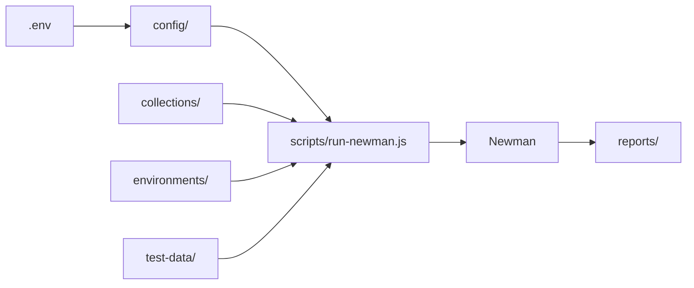

# Postman + Newman API Collections

Postman collection and Newman runner for the [JSONPlaceholder](https://jsonplaceholder.typicode.com) demo API. It is a practice project, not a real product backend. JSONPlaceholder does not save changes, so POST, PUT, PATCH and DELETE return fake success responses.

## What is covered

- Posts: get all, get one, create, full update (PUT), partial update (PATCH), delete
- Users: get all
- Comments: get comments for post 1 (`?postId={{postId}}`)
- Negative cases: get a post that does not exist (`/posts/{{nonExistentPostId}}`), get an invalid endpoint
- Auth (`collections/auth-negative.postman_collection.json`, 7 requests, 21 assertions): basic auth valid / wrong password and bearer token valid / missing against httpbin, plus create post missing title and body (documents that the fake API accepts it with 201), non-existent post and invalid endpoint
- Schema validation (`collections/schema-validation.postman_collection.json`, 5 requests, 20 assertions): response schemas for the posts and users endpoints, checked two ways per request, a `tv4` JSON-schema validation against the `postSchema` / `userSchema` collection variables, and an explicit required-fields-and-types check. Default iteration data is `test-data/posts.csv` (3 rows), so it runs once per CSV row

Each request has test scripts that check the status code, response time (against the `maxResponseTimeMs` variable, default 2000 ms), and the JSON fields returned. A collection-level pre-request script adds an `X-Request-Timestamp` header to every request. No URL, id, payload value or timeout is hard-coded in a request or test script: they all come from collection, environment or data-file variables (see `ARCHITECTURE.md`).

## Folder tree

```text
├── collections/    three Postman collections (10 + 7 + 5 requests, 33 + 21 + 20 assertions)
├── config/         newman.config.json — timeouts, reporters, defaults
├── docs/           SETUP.md, TESTING.md
├── environments/   dev + prod (both point at the same demo API)
├── scripts/        run-newman.js + .sh / .bat wrappers
├── test-data/      posts.json / posts.csv iteration data, users.json reference
└── reports/        generated HTML + JSON reports (git-ignored)
```

## Setup

```bash
npm install
cp .env.example .env   # optional, for local overrides
```

Details: `docs/SETUP.md`.

## Run

```bash
npm test              # all three collections, dev environment, terminal + HTML + JSON reports
npm run test:html     # same, explicit
npm run test:prod     # all three collections, prod environment
npm run test:data     # data-driven run with test-data/posts.json (3 rows)
npm run test:csv      # data-driven run with test-data/posts.csv (3 rows)
npm run test:auth     # auth collection only
npm run test:schema   # schema collection only, data-driven from test-data/posts.csv (3 rows)
npm run test:schema-csv  # schema collection only, explicit --data test-data/posts.csv
```

Or directly:

```bash
./scripts/run-newman.sh [--env dev|prod] [--data test-data/posts.json]
```

On Windows, use `scripts\run-newman.bat`. Reports go to `reports/report.html` and `reports/report.json`.

Common overrides (no file editing needed):

```bash
NEWMAN_ENV=prod npm test
BASE_URL=https://jsonplaceholder.typicode.com ./scripts/run-newman.sh
./scripts/run-newman.sh --data test-data/posts.json --iterations 1
```

Full list: `.env.example`, `config/newman.config.json`, `docs/SETUP.md`.

## Import into Postman

1. Open Postman, go to Import, and pick `collections/jsonplaceholder-api.postman_collection.json` (and `collections/schema-validation.postman_collection.json` for the schema checks).
2. Import an environment too: `environments/dev.postman_environment.json` (or `prod.postman_environment.json`).
3. Select that environment in the top right, then run the collection with the Collection Runner.

Both environments point at the same public demo API. The only difference is the `envName` label (`dev` vs `prod`). There is no real prod backend here.

## Verified results

Honest status, verified 2026-11-20:

- All JSON files in the repo parse cleanly (`python3 -m json.tool`, validated 2026-11-25): collection, schema collection, auth collection, both environments, `config/newman.config.json`, `test-data/posts.json`, `test-data/users.json`, `package.json`.
- `scripts/run-newman.sh` passes `bash -n` (syntax check).
- `scripts/run-newman.js` passes `node --check`.
- Collection structure confirmed: 10 requests, 33 `pm.test` assertions in the main collection; 7 requests, 21 assertions in the auth collection; 5 requests, 20 assertions in the schema collection (5 `tv4.validateResult` schema checks plus 5 required-fields-and-types checks, plus status and response-time checks); no hard-coded host, id, credential or timeout remains in any request URL, body or test script (values live in collection/environment/data-file variables). The `postSchema` and `userSchema` collection variables parse as valid JSON schemas.
- **Newman was not run.** Newman is not installed in this environment (`node_modules/` does not exist) and none of the collections has ever been executed, so there are no pass/fail numbers to report. Run it yourself (`npm install && npm test`) and read `reports/report.html`, `reports/report-auth.html` and `reports/report-schema-validation.html` for the current state. See `docs/TESTING.md`.

## Diagram


